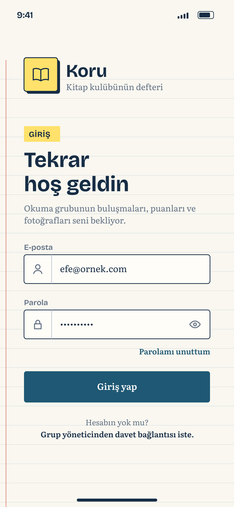
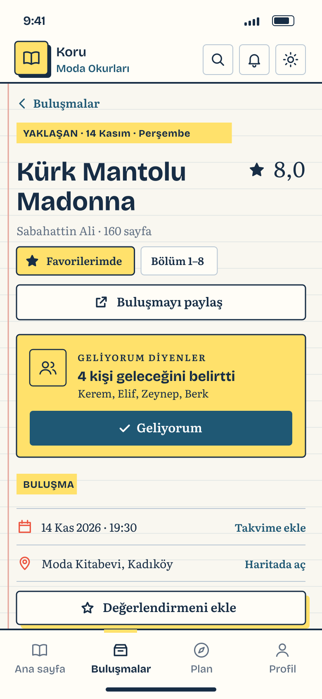
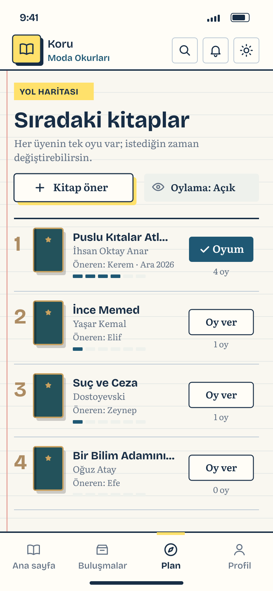
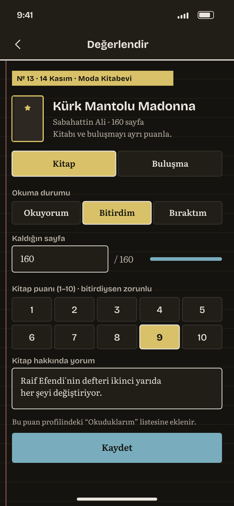
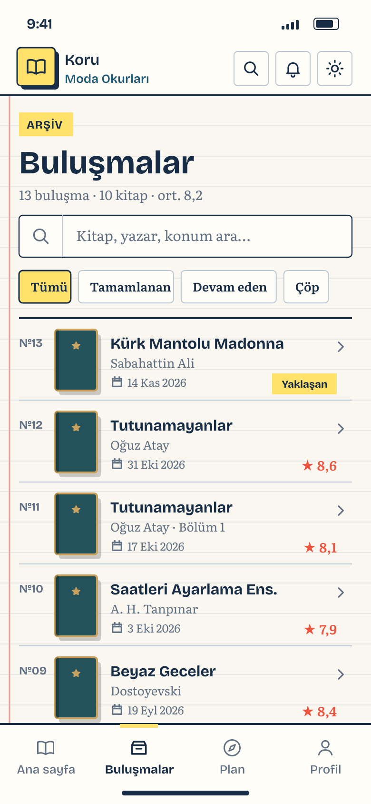
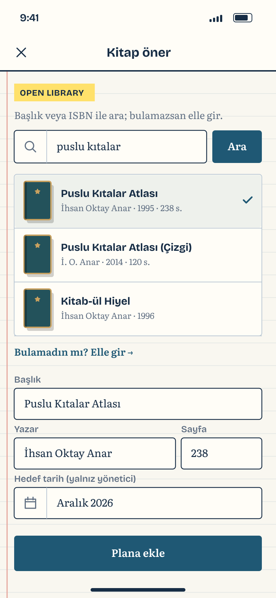
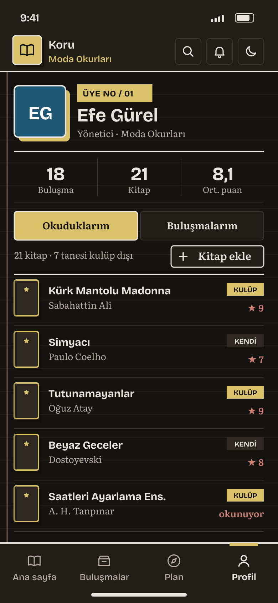

# Koru

**MTM4681 Mobile Programming · Project Milestone 1 (design & architecture)**
Team 4 · Yıldız Technical University · Fall 2026 · Repository: [muhammetkeremaydin/koru-mobile-app](https://github.com/muhammetkeremaydin/koru-mobile-app)

**Koru** is a native Flutter (Android + iOS) app for small, in-person Turkish book clubs: see the next meeting, say “Geliyorum”, rate and review the book, and vote on what to read next, with the club's history kept automatically. Data lives in Firebase (Authentication + Cloud Firestore); book details come from the Open Library API.

## Contributors

| Name | GitHub | Main responsibility |
| --- | --- | --- |
| Ahmet Efe Gürel | [@ahmetefegurel](https://github.com/ahmetefegurel) | Firebase data layer, auth, meeting & review features |
| Muhammet Kerem Aydın | [@muhammetkeremaydin](https://github.com/muhammetkeremaydin) | Design system, navigation, plan & profile features |

## Figma (view access granted to the instructor)

| Deliverable | Link |
| --- | --- |
| Figma file (wireframes, mockups, styles, prototype) | https://www.figma.com/design/XKC6fYGfZ3pcLfCgGDakab |
| Wireframes (page `01 Wireframes`) | https://www.figma.com/design/XKC6fYGfZ3pcLfCgGDakab?node-id=0-1 |
| Mockups light + dark, color variables, text styles, components (page `02 Mockups & Styles`) | https://www.figma.com/design/XKC6fYGfZ3pcLfCgGDakab?node-id=1-4 |
| Prototype (page `03 Prototype`) | https://www.figma.com/design/XKC6fYGfZ3pcLfCgGDakab?node-id=1-5 |
| Prototype, presentation view (flow “Ana akış”) | https://www.figma.com/proto/XKC6fYGfZ3pcLfCgGDakab?node-id=9-2&starting-point-node-id=9%3A2 |

## Milestone 1 deliverables

| # | Deliverable | File |
| --- | --- | --- |
| 0 | **Milestone report** (problem, competitor analysis, features → course topics) | [`docs/milestone-report.pdf`](docs/milestone-report.pdf) |
| 1 | Design justification (2 pages) | [`docs/design-justification.pdf`](docs/design-justification.pdf) |
| 2 | User flow diagram | [`docs/user-flow.pdf`](docs/user-flow.pdf) |
| 3 | Wireframes | Figma + [`design/wireframes/`](design/wireframes) |
| 4 | Mockups | Figma + [`design/mockups/`](design/mockups) |
| 5 | Prototype | Figma (connections documented in [`design/FIGMA.md`](design/FIGMA.md)) |
| 6 | Architecture & protocols | [`docs/architecture-protocols.pdf`](docs/architecture-protocols.pdf) |

## Screens

| | | | |
| --- | --- | --- | --- |
|  |  |  |  |
| 01 Giriş | 03 Ana sayfa | 05 Buluşma detayı | 07 Plan |
|  |  |  |  |
| 06 Değerlendirme (dark) | 04 Buluşmalar | 08 Kitap öner | 09 Profil (dark) |

## MVP features → course topics

| Feature | Course topic |
| --- | --- |
| Login, session, group selection, auth-guarded routes | Firebase Auth, navigation (`go_router` redirect) |
| Home / meetings list / meeting detail with tabs that keep state | Widgets & layouts, `StatefulShellRoute` |
| Meetings, plans, reviews synced live from Cloud Firestore | Cloud data, async streams, error states |
| RSVP, rating 1–10, voting with one active vote | MVVM + Provider (`ChangeNotifier`) |
| Book search (Open Library) | Networking: `http` + JSON |
| Offline meeting history, favorites, saved accounts, review drafts | Local DB: `sqflite` (SQLite), `shared_preferences` |
| Bottom-sheet review, vote and RSVP transitions | Animation |

## Tech stack (planned)

Flutter 3 · Dart 3 · `firebase_core` · `firebase_auth` · `cloud_firestore` · `sqflite` · `provider` · `go_router` · `http` · `shared_preferences` · `google_fonts` · `intl` · `share_plus` · `url_launcher` · `app_links`

## Repository layout

```
docs/      PDFs for the milestone (+ diagram sources in docs/src)
design/    wireframes/ and mockups/ (SVG, importable into Figma), previews/ (PNG), FIGMA.md
```

The Flutter source (`lib/`, `test/`, `pubspec.yaml`) is added from the next milestone on.
